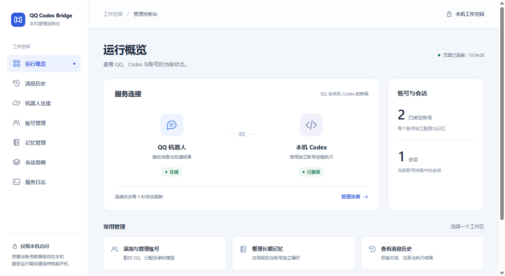

# QQ–Codex Bridge

**在 QQ 里，把任务交给你的本机 Codex。**

发需求、补充上下文、确认审批、接收文件。每个 QQ 账号拥有独立的工作目录、会话、模型和记忆；电脑上的任务，在手机上也能跟进。

[快速开始](#快速开始) · [QQ 指令](docs/COMMANDS.md) · [维护手册](docs/RUNBOOK.md) · [MIT 许可](LICENSE)


*截图使用离线合成数据，不含真实账号或聊天。*

<details>
<summary>查看运行概览</summary>



</details>

## 能做什么

| 能力 | 使用方式 |
| --- | --- |
| 对话执行任务 | 直接发文字；连续消息自动合并，执行中还能补充要求 |
| 多账号独立使用 | 进程、项目目录、会话、审批、模型和私有记忆分别隔离 |
| 收发图片与文件 | 图片交给模型，语音转写，视频抽样分析，结果可回传为附件 |
| 保留长期偏好 | 手动保存记忆，也可自动提炼；支持查看依据、编辑和关闭自动学习 |
| 控制任务与模型 | 查看进度、停止任务、回答审批，按账号选择模型与推理强度 |
| 统一管理控制台 | 配对、记忆、会话策略、消息搜索、导出和任务阶段都在同一界面 |

## 快速开始

准备 **Windows、Node.js 24、已安装并登录的 Codex**，以及自行创建的 QQ 官方机器人。语音和视频处理另需 FFmpeg/FFprobe、Python 与本地识别模型。

```powershell
git clone https://github.com/Sakata-Eof/qq-codex-bridge.git
cd qq-codex-bridge
npm ci
```

启动脚本和媒体默认路径仍有本机环境假设。首次部署先按[安装检查](docs/RUNBOOK.md#换机或重新安装)核对路径，再启动：

```powershell
./Start.ps1
```

在控制台填写机器人 AppID 和 AppSecret，生成配对码；使用对应 QQ 账号私聊机器人发送 `/pair 配对码`。绑定后，在“账号管理”分配项目目录，就可以直接发送任务：

> 查看当前项目，先总结结构，再列出最值得解决的三个问题。

已有实例可从 Windows 开始菜单打开“Codex QQ 控制台”。后台运行无需保留终端窗口；`./Stop.ps1` 用于安全停机，正在执行或投递时会拒绝停止。

## 常用指令

| 指令 | 用途 |
| --- | --- |
| `/help`、`/buttons` | 帮助与按钮菜单 |
| `/status`、`/context`、`/result` | 查看进度、上下文和最近结果 |
| `/stop`、`/new` | 停止当前任务、开始新会话 |
| `/models`、`/model` | 选择模型、查看当前设置 |
| `/file 绝对路径` | 回传账号允许目录内的文件 |
| `/memory`、`/remember 内容` | 查看或添加账号记忆 |

完整用法见 [QQ 指令](docs/COMMANDS.md)。审批和询问也可通过 QQ 原生按钮回答。

## 运行说明

- 电脑需保持开机；本机服务默认监听 `127.0.0.1:17329`，群聊默认不开放。
- 模型执行和 QQ 投递分别记录；结果不明确时先核对，不自动重跑任务或重发回复。媒体能否投递以 QQ 接口实际结果为准。
- `runtime/` 保存凭据、账号记忆和聊天数据；`exports/` 保存导出与私有验证资料。请勿提交或公开这些目录。

## 文档与开发

| 文档 | 内容 |
| --- | --- |
| [项目概览](PROJECT.md) · [架构](docs/ARCHITECTURE.md) | 模块结构与账号边界 |
| [维护手册](docs/RUNBOOK.md) | 配置、启动、备份、升级与故障排查 |
| [开发约定](CONTRIBUTING.md) | 修改、验证与提交流程 |
| [任务状态](docs/TASKS.md) | 执行、投递与待核实状态 |
| [变更记录](CHANGELOG.md) · [待办](docs/BACKLOG.md) | 已交付内容与待验收范围 |

```powershell
npm run check     # 语法、导入与页面资源
npm test          # 离线回归测试
node scripts/probes/setup-ui-preview.mjs  # 合成数据界面预览
```

预览不连接 QQ 或 Codex，输入 `quit` 退出。真实调用探针与离线测试的区别见[开发约定](CONTRIBUTING.md#验证怎么选)。

[MIT](LICENSE) · 外部软件、模型和平台服务遵循[各自条款](THIRD_PARTY.md)。
